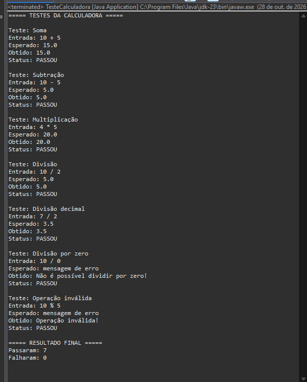
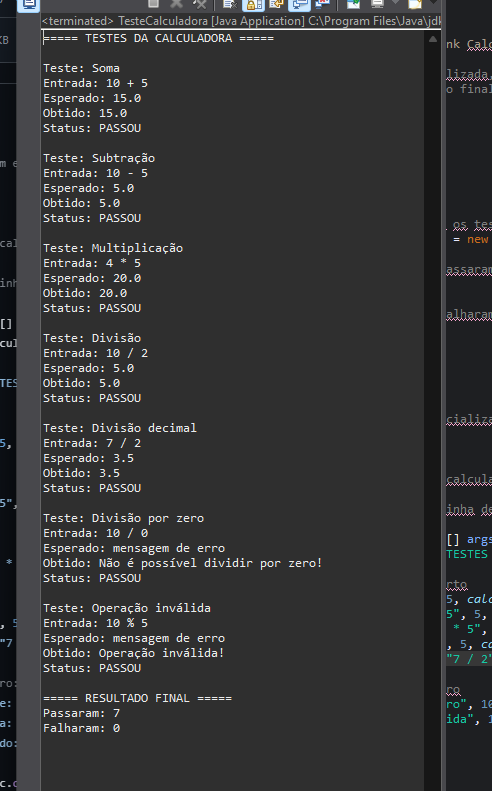
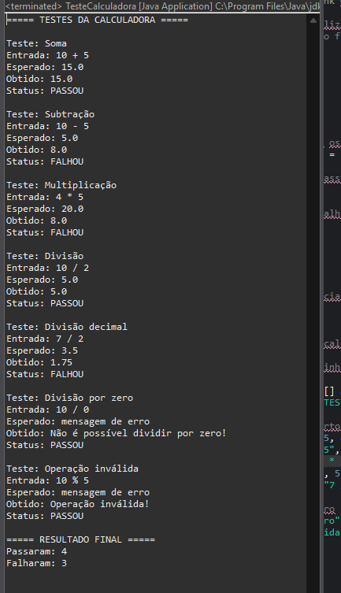
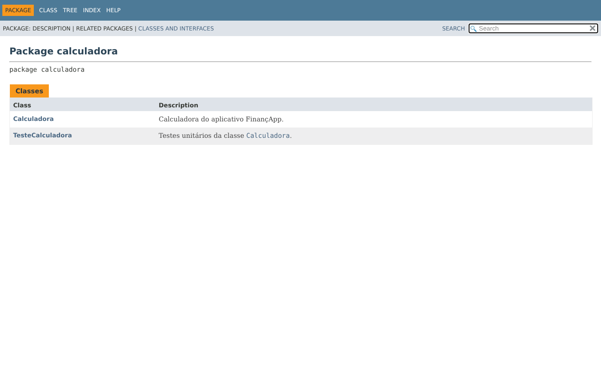
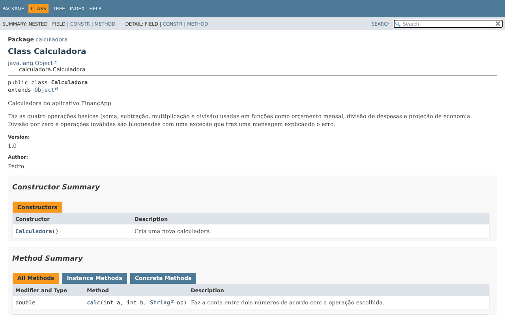
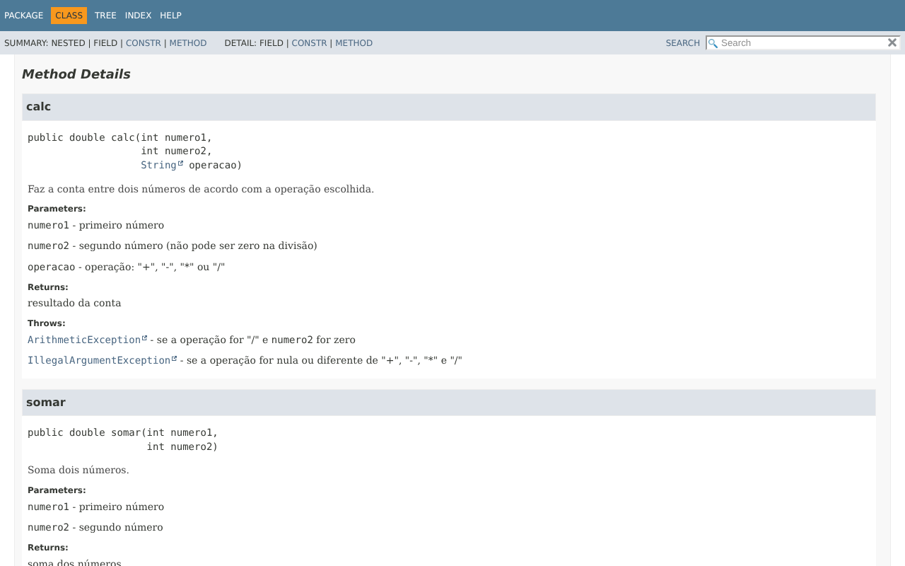

# Projeto Calculadora — FinançApp

> Projeto acadêmico desenvolvido com foco em Qualidade de Software, Testes, Refatoração, Documentação e Versionamento.

---

## 1. Identificação do Projeto

**Projeto:** Projeto Calculadora  
**Contexto:** FinançApp  
**Aluno:** Pedro Jorge  
**RA:** 250972      
**Curso:** Análise e Desenvolvimento de Sistemas      
**Disciplina:** UX/UI e Teste de Software  
**Professor:** Daniel Ohata  
**Semestre:** 2026.2  
**Repositório:** https://github.com/PedroJorge32/Projeto_Calculadora_UxUi

---

# 2. Visão Geral

O projeto consiste no desenvolvimento de um módulo de cálculos matemáticos básicos em Java para a startup fictícia **FinançApp**.

O módulo foi desenvolvido para ser usado futuramente em funcionalidades de controle financeiro, como:

- orçamento mensal;
- divisão de despesas;
- projeções financeiras;
- cálculos auxiliares.

Além do funcionamento correto das operações, o projeto aplica práticas de qualidade de software relacionadas a:

- testes;
- tratamento de erros;
- refatoração;
- documentação;
- versionamento;
- manutenção de código.

---

# 3. Problema

Durante o desenvolvimento da aplicação FinançApp, foi identificada a necessidade de criar um módulo matemático reutilizável.

A equipe definiu que o módulo não deveria apenas funcionar corretamente, mas também apresentar:

- código legível;
- testes automatizados;
- tratamento de falhas;
- documentação técnica;
- controle de versões;
- facilidade de manutenção.

O desafio, portanto, é desenvolver uma solução funcional aplicando boas práticas de Engenharia de Software.

---

# 4. Objetivo

## 4.1 Objetivo Geral

Desenvolver uma calculadora em Java aplicando práticas de qualidade, testes, documentação, refatoração e versionamento.

## 4.2 Objetivos Técnicos

- implementar operações matemáticas básicas;
- tratar entradas inválidas;
- impedir divisão por zero;
- desenvolver testes automatizados;
- refatorar o código sem alterar seu comportamento;
- documentar classes e métodos com JavaDoc;
- gerar documentação HTML;
- utilizar Git e GitHub;
- organizar commits e branches;
- manter documentação técnica no README.

---

# 5. Escopo Funcional

| ID | Funcionalidade | Descrição | Status |
|---|---|---|---|
| RF01 | Soma | Soma dois números inteiros | ✅ |
| RF02 | Subtração | Subtrai dois números inteiros | ✅ |
| RF03 | Multiplicação | Multiplica dois números inteiros | ✅ |
| RF04 | Divisão | Divide dois números inteiros, mantendo as casas decimais | ✅ |
| RF05 | Validação de divisão | Impede divisão por zero | ✅ |
| RF06 | Operação inválida | Trata operadores não suportados | ✅ |

---

# 6. Requisitos Não Funcionais

| ID | Categoria | Requisito |
|---|---|---|
| RNF01 | Qualidade | O código deve possuir organização e legibilidade |
| RNF02 | Testabilidade | As operações devem possuir testes automatizados |
| RNF03 | Manutenção | O código deve permitir refatoração sem alteração funcional |
| RNF04 | Documentação | Classes e métodos devem possuir JavaDoc |
| RNF05 | Versionamento | O projeto deve utilizar Git e GitHub |
| RNF06 | Confiabilidade | Erros não devem interromper inesperadamente a execução |

---

# 7. Tecnologias Utilizadas

| Tecnologia | Versão | Utilização |
|---|---|---|
| Java | 23 | Desenvolvimento |
| JDK | 23 | Compilação |
| Testes em Java puro | — | Testes (classe `TesteCalculadora`, sem bibliotecas externas) |
| Git | — | Controle de versão |
| GitHub | — | Repositório remoto |
| JavaDoc | — | Documentação |
| Eclipse IDE | — | Ambiente de desenvolvimento |

Os testes foram escritos em Java puro, sem JUnit, para que o projeto rode em qualquer IDE sem configurar bibliotecas.

---

# 8. Estrutura do Projeto

```text
projeto_calculadora/
│
├── src/
│   └── calculadora/
│       ├── Calculadora.java
│       └── TesteCalculadora.java
│
├── docs/
│   └── index.html
│
├── imagens/
│   ├── testes_main.png
│   ├── testes_refatoracao.png
│   ├── testes_falha.png
│   ├── javadoc_index.png
│   ├── javadoc_calculadora.png
│   └── javadoc_metodos.png
│
├── README.md
├── .gitignore
├── .classpath
└── .project
```

---

# 9. Operações

O método principal é `calc(int a, int b, String op)`. Ele recebe dois números inteiros e o símbolo da operação e devolve o resultado como `double`.

| Operação | Símbolo | Exemplo | Resultado |
|---|---|---|---|
| Soma | `+` | `calc(10, 5, "+")` | `15.0` |
| Subtração | `-` | `calc(10, 5, "-")` | `5.0` |
| Multiplicação | `*` | `calc(4, 5, "*")` | `20.0` |
| Divisão | `/` | `calc(7, 2, "/")` | `3.5` |

O retorno é `double` para a divisão manter as casas decimais (`7 / 2` resulta em `3.5`, e não `3`).

## 9.1 Tratamento de Erros

| Situação | Exemplo | Comportamento |
|---|---|---|
| Divisão por zero | `calc(10, 0, "/")` | Lança `ArithmeticException` com a mensagem "Não é possível dividir por zero!" |
| Operação inválida | `calc(10, 5, "%")` | Lança `IllegalArgumentException` com a mensagem "Operação inválida!" |

As exceções são capturadas com `try/catch`. O programa mostra a mensagem de erro e continua a execução.

---

# 10. Testes Unitários

A classe `TesteCalculadora` executa 7 testes. Cada um mostra a entrada utilizada, o resultado esperado, o resultado obtido e o status (PASSOU ou FALHOU).

| Teste | Entrada | Esperado |
|---|---|---|
| Soma | `10 + 5` | `15.0` |
| Subtração | `10 - 5` | `5.0` |
| Multiplicação | `4 * 5` | `20.0` |
| Divisão | `10 / 2` | `5.0` |
| Divisão decimal | `7 / 2` | `3.5` |
| Divisão por zero | `10 / 0` | mensagem de erro |
| Operação inválida | `10 % 5` | mensagem de erro |

## 10.1 Execução na branch `main` (antes da refatoração)



## 10.2 Execução na branch `Refatoracao` (depois da refatoração)



Nas duas versões os 7 testes passaram, o que mostra que a refatoração não alterou o comportamento do sistema.

## 10.3 Verificação de falha

Para confirmar que os testes realmente detectam erros, os números de três contas foram alterados de propósito (por exemplo, `calc(10, 2, "-")` no lugar de `calc(10, 5, "-")`). Os testes acusaram **FALHOU** nesses casos, e a execução continuou até o resumo final. Depois da verificação, os valores originais foram restaurados.



---

# 11. Refatoração

A refatoração foi feita na branch `Refatoracao`, sem alterar o resultado de nenhuma operação.

| Técnica | Antes (`main`) | Depois (`Refatoracao`) |
|---|---|---|
| Extração de métodos | Toda a lógica dentro de `calc` | Métodos `somar`, `subtrair`, `multiplicar` e `dividir` |
| Simplificação de condicionais | `if/else` aninhados | `if` simples com `return` direto |
| Nomes de variáveis | `a`, `b`, `op`, `r` | `numero1`, `numero2`, `operacao` |
| Organização lógica | Verificação da divisão por zero dentro do `calc` | Verificação dentro do método `dividir` |
| Testes sem repetição | Dois blocos `try/catch` repetidos no `main` | Métodos `testarErro`, `mostrarCabecalho`, `registrar` e `mostrarResumo` |

Versão inicial do método `calc`:

```java
public double calc(int a, int b, String op) {
    double r;
    if (op == null) {
        throw new IllegalArgumentException("Operação inválida!");
    } else if (op.equals("+")) {
        r = a + b;
    } else if (op.equals("-")) {
        r = a - b;
    } else if (op.equals("*")) {
        r = a * b;
    } else if (op.equals("/")) {
        if (b == 0) {
            throw new ArithmeticException("Não é possível dividir por zero!");
        } else {
            r = (double) a / b;
        }
    } else {
        throw new IllegalArgumentException("Operação inválida!");
    }
    return r;
}
```

Versão refatorada:

```java
public double calc(int numero1, int numero2, String operacao) {
    if ("+".equals(operacao)) {
        return somar(numero1, numero2);
    }
    if ("-".equals(operacao)) {
        return subtrair(numero1, numero2);
    }
    if ("*".equals(operacao)) {
        return multiplicar(numero1, numero2);
    }
    if ("/".equals(operacao)) {
        return dividir(numero1, numero2);
    }
    throw new IllegalArgumentException("Operação inválida!");
}
```

Após a refatoração, todos os testes foram executados novamente e passaram (seção 10.2).

---

# 12. Documentação JavaDoc

As classes, os atributos, os construtores e os métodos foram documentados com JavaDoc, usando as anotações `@author`, `@version`, `@param`, `@return` e `@throws`. O código também possui comentários técnicos (`//`) explicando trechos importantes.

A documentação HTML foi gerada na pasta `docs/`. Para visualizar, abra o arquivo `docs/index.html` no navegador.

Comando utilizado:

```bash
javadoc -encoding UTF-8 -charset UTF-8 -author -version -d docs -sourcepath src calculadora
```

### Página inicial



### Classe Calculadora



### Detalhes dos métodos



---

# 13. Versionamento

| Branch | Conteúdo |
|---|---|
| `main` | Versão inicial da calculadora e dos testes, com JavaDoc (versão 1.0) |
| `Refatoracao` | Versão refatorada, com JavaDoc (versão 2.0) |

Histórico de commits:

| Branch | Commit |
|---|---|
| `main` | Cria projeto e implementa a classe Calculadora |
| `main` | Adiciona testes em TesteCalculadora |
| `main` | Adiciona JavaDoc e comentários técnicos (versão 1.0) |
| `main` | Gera documentação JavaDoc na pasta docs |
| `Refatoracao` | Refatora Calculadora e TesteCalculadora |
| `Refatoracao` | Adiciona JavaDoc e comentários técnicos (versão 2.0) |
| `Refatoracao` | Gera documentação JavaDoc na pasta docs |
| ambas | Adiciona README.md |

---

# 14. Como Executar

No Eclipse: botão direito em `TesteCalculadora.java` > **Run As** > **Java Application**.

Pelo terminal, na pasta do projeto:

```bash
javac -encoding UTF-8 -d bin src/calculadora/*.java
java -cp bin calculadora.TesteCalculadora
```

---

# 15. Link do Repositório

https://github.com/PedroJorge32/Projeto_Calculadora_UxUi
